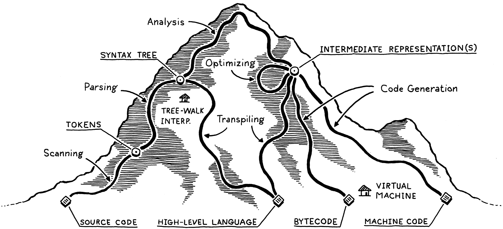
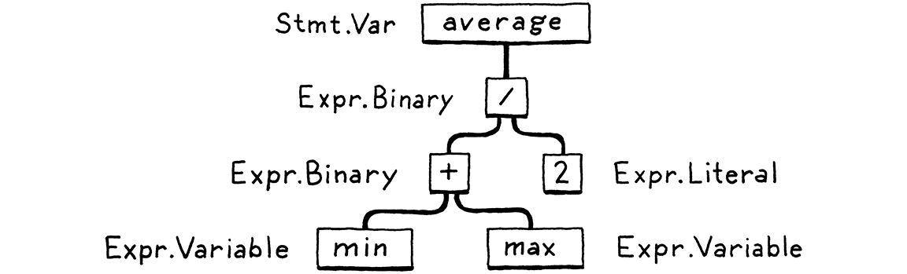

# Chapter 2

  

This is a really cool representation of how the flow of an interpreter or compiler looks. I really wish I could create illustrations like that for my journal later.

This mountain shows the steps our interpreter or compiler takes to transform a stream of characters into a higher level representation of our language, and then find its way down to something the CPU can understand.

## Scanning

This is the first step the compiler or interpreter takes. It is also known as lexing or lexical analysis, though I prefer calling it **scanning**. The scanner's job is to take a stream of characters or bytes and turn them into **tokens**. Tokens are meaningful chunks of characters like words in our language such as identifiers, variable names, keywords, or special punctuation characters.

## Parsing

At this stage, the parser takes the sequence of tokens and makes structural sense of it. If we have variables `a` and `b` and an expression like `(a + b) / 2`, we know from order of operations (PEMDAS) that the expression inside `()` comes first even though division comes after it. The parser handles that by applying grammar rules and building a tree-like structure (an Abstract Syntax Tree, or AST) out of the tokens.

I have a feeling working on this will be a lot of fun since I have never worked with tree structures before. The parser is also responsible for catching and reporting **syntax errors**.

Here is a really good illustration of that tree structure:

  

## Static Analysis

At this stage, we check the regions where variables are defined in other words, their **scopes** to determine whether they are accessible for interactions with each other. That process is called **binding** or **resolution**. After that, we check types to see if an operation like addition is valid. We should not be able to add a string and an integer together this is not JavaScript. If there is a type mismatch, the compiler or interpreter should report a **type error** to the programmer.

There are a few ways to store this extra information about the user's program:

- Save it as attributes directly inside the tree nodes.
- Store it in a separate data structure or table (like a symbol table).
- Transform the tree into an entirely new data structure that expresses the semantics of the code.

It looks like everything up to this point—scanning, parsing, and static analysis—makes up the **front end** of a compiler, much like a front end in web applications has a matching back end.

## Intermediate Representations

This is another form of representation of the user's code produced by the front end. An **Intermediate Representation (IR)** acts as an interface between source languages and target architectures, making it much easier to support multiple languages and CPU architectures without duplicating everything. I am still a bit blurry on this concept and do not fully grasp IR yet, but once I actually write code that uses one, it will probably click.

## Optimization

At this stage, the compiler understands what the user's code is trying to do and can rewrite or restructure parts of it so the CPU can understand and execute it more efficiently—without changing what the program actually does. The goal is simply to make execution as fast and resource-friendly as possible.

## Code Generation

This is where the **back end** of a compiler really kicks in. Here we decide whether to generate instructions for a real CPU or for a **virtual machine (VM)**. Each option has trade-offs:

- **Virtual machine bytecode:** More portable across different computers, though generally slower than native machine code.
- **Native CPU instructions:** Faster at runtime, but takes more effort to implement and is tied to a specific CPU architecture.

Finally, the core difference between compiling and interpreting is that a **compiler** translates higher-level code into a lower-level form that the user runs afterward, whereas an **interpreter** translates and executes the program directly as it runs.
